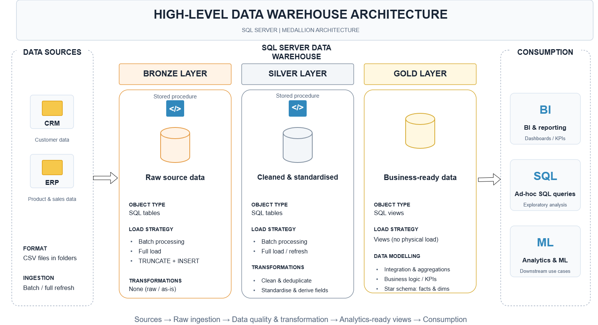
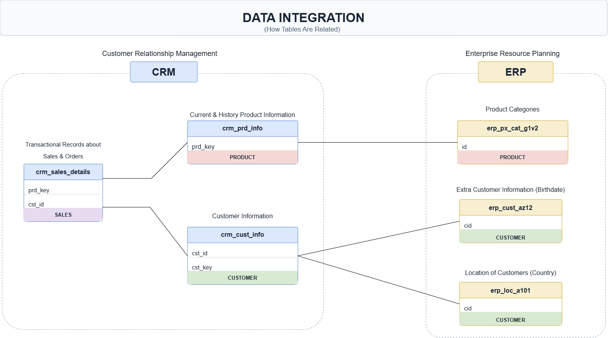
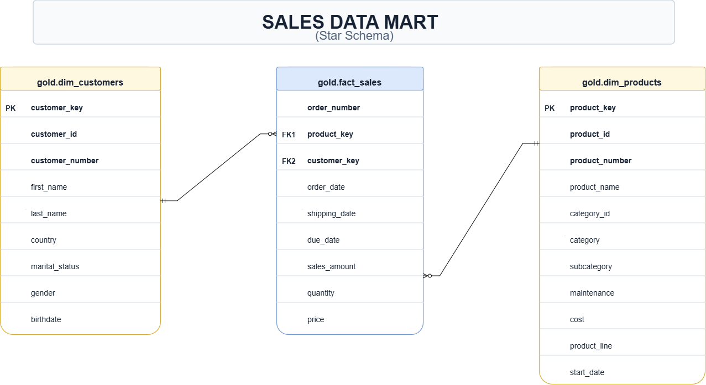

# SQL Data Warehouse | End-to-End ETL & Sales Analytics

An end-to-end data warehouse built in **SQL Server** using the **Medallion Architecture** (Bronze → Silver → Gold). It ingests raw CSV exports from two source systems, a CRM and an ERP, cleans and integrates them, and publishes a **star schema** ready for BI reporting and ad-hoc analysis.
 


## Overview

Business data often lives in separate operational systems, with inconsistent identifiers, duplicate records, differing formats and invalid values. This project demonstrates how to consolidate **CRM (customer relationship management)** and **ERP (enterprise resource planning)** CSV extracts in Microsoft SQL Server and prepare them for reliable downstream analysis.

The solution follows a three-layer **Bronze → Silver → Gold** design:

- **Bronze:** Preserve source data in six staging tables and bulk-load CSV files.
- **Silver:** Clean, standardise, deduplicate and reconcile CRM and ERP records using T-SQL transformations.
- **Gold:** Expose a sales-oriented star schema through SQL views, ready for BI queries and reporting.

The focus is the **data engineering foundation**, not a finished BI dashboard: data ingestion, transformation, modelling and validation are implemented in the repository.

## Architecture



**Data flow:** CRM and ERP CSV files → Bronze staging tables → Silver cleansed tables → Gold analytical views → SQL analysis / BI tools.

| Layer | Implementation | Purpose |
| --- | --- | --- |
| **Bronze** | Six SQL Server tables; `BULK INSERT`; `bronze.load_bronze` | Ingest source extracts with minimal transformation |
| **Silver** | Six SQL Server tables; `silver.load_silver` | Apply business rules, resolve data quality issues and align source keys |
| **Gold** | `gold.dim_customers`, `gold.dim_products`, `gold.fact_sales` **views** | Provide a reusable dimensional interface for sales analysis |

> **Design note:** The stored procedures use a full-refresh pattern (`TRUNCATE` followed by load). This is a local batch ETL project; it does not claim incremental ingestion, cloud orchestration or production deployment.

## Source Data and Integration

The project combines **six CSV datasets** from two source domains.

| Source | Dataset | Target staging table | Content |
| --- | --- | --- | --- |
| CRM | `cust_info.csv` | `bronze.crm_cust_info` | Customer identifiers, names and attributes |
| CRM | `prd_info.csv` | `bronze.crm_prd_info` | Product details, categories, costs and validity dates |
| CRM | `sales_details.csv` | `bronze.crm_sales_details` | Orders, dates, quantities, prices and sales |
| ERP | `CUST_AZ12.csv` | `bronze.erp_cust_az12` | Customer birth dates and gender |
| ERP | `LOC_A101.csv` | `bronze.erp_loc_a101` | Customer location and country |
| ERP | `PX_CAT_G1V2.csv` | `bronze.erp_px_cat_g1v2` | Product category and subcategory information |



To combine the systems, the Silver layer normalises customer identifiers (including source-specific prefixes and hyphens) and separates product category identifiers from CRM product keys. The Gold layer joins the cleaned data into customer and product dimensions.

## ETL Pipeline

### 1. Bronze — source ingestion

The `bronze.load_bronze` stored procedure loads the six files with SQL Server `BULK INSERT`. It truncates the target staging tables before each refresh, skips CSV header rows and prints per-table and batch execution times. A `TRY...CATCH` block prints SQL Server error details.

**Scripts:** [`ddl_bronze.sql`](scripts/bronze/ddl_bronze.sql) · [`proc_load_bronze.sql`](scripts/bronze/proc_load_bronze.sql)

### 2. Silver — cleaning and standardisation

The `silver.load_silver` procedure transforms staged source data into consistently typed tables. Notable transformations in the SQL include:

| Data quality problem | Implemented transformation |
| --- | --- |
| Repeated customer records | `ROW_NUMBER()` partitioned by customer ID keeps the latest record by creation date |
| Inconsistent names and labels | `TRIM()`, `UPPER()` and `CASE` normalise customer names, gender and marital-status codes |
| Product identifiers mix category and product keys | `SUBSTRING()` and `REPLACE()` derive separate joinable identifiers |
| Missing product cost and coded product lines | `ISNULL()` and `CASE` handle missing cost and expand product-line codes |
| Product validity periods | `LEAD()` derives a prior version's end date from the following start date |
| Sales dates stored as integers | Valid-length `YYYYMMDD` values are converted to SQL `DATE`; zero or wrong-length values become `NULL` |
| Invalid sales amounts or unit prices | Conditional calculations reconcile sales, quantity and price |
| ERP identifiers and locations disagree with CRM | Prefix/hyphen removal and country-name standardisation align customer records |
| Future birth dates | Future-dated birth dates are replaced with `NULL` |

Silver tables also contain a `dwh_create_date` column defaulting to the current load timestamp.

**Scripts:** [`ddl_silver.sql`](scripts/silver/ddl_silver.sql) · [`proc_load_silver.sql`](scripts/silver/proc_load_silver.sql)

### 3. Gold — dimensional analytics model

The Gold layer uses **three SQL views**, defined in [`ddl_gold.sql`](scripts/gold/ddl_gold.sql):

- **`gold.dim_customers`:** Joins CRM customer records to ERP demographic and country attributes. CRM gender takes precedence, with ERP used as a fallback. Includes a query-generated `customer_key`.
- **`gold.dim_products`:** Enriches CRM products with ERP product categories, subcategories and maintenance attributes; keeps product rows with `prd_end_dt IS NULL` (the current product version according to the model). Includes a query-generated `product_key`.
- **`gold.fact_sales`:** Links sales records to the customer and product views and exposes order number, order/shipping/due dates, sales amount, quantity and unit price.



This **star-schema-style reporting layer** simplifies queries across sales, customer and product attributes. Since it is defined with views, the Gold data is computed from the Silver tables when queried rather than stored in separate physical fact and dimension tables.

**Example analysis:**

```sql
-- Revenue and order activity by product category
SELECT
    p.product_category,
    COUNT(DISTINCT f.order_number) AS total_orders,
    SUM(f.sales_amount) AS total_sales,
    SUM(f.quantity) AS units_sold
FROM gold.fact_sales AS f
LEFT JOIN gold.dim_products AS p
    ON f.product_key = p.product_key
GROUP BY p.product_category
ORDER BY total_sales DESC;
```

This query is an illustrative use of the warehouse model; it is not a claim of measured business findings.

## Data Quality Checks

The repository includes separate SQL check scripts for the Silver and Gold layers.

| Area | Checks included |
| --- | --- |
| **Silver: keys** | Null or duplicate customer/product identifiers |
| **Silver: formatting** | Unexpected whitespace and inconsistent categorical values |
| **Silver: dates** | Product date ordering, sales date ordering and out-of-range birth dates; one source-date check examines Bronze data |
| **Silver: financial consistency** | Positive/non-null sales, quantity and price; `sales = quantity × price` |
| **Gold: model integrity** | Duplicate dimension surrogate keys and fact rows that do not resolve to both dimensions |

Run [`quality_checks_silver.sql`](tests/quality_checks_silver.sql) after the Silver load and [`quality_checks_gold.sql`](tests/quality_checks_gold.sql) after creating the Gold views. **These are diagnostic SQL queries**: inspect their output for anomalies; the repository does not include an automated pass/fail test runner or published test results.

## Project Structure

```text
sql-data-warehouse-project/
├── datasets/
│   ├── source_crm/
│   │   ├── cust_info.csv
│   │   ├── prd_info.csv
│   │   └── sales_details.csv
│   └── source_erp/
│       ├── CUST_AZ12.csv
│       ├── LOC_A101.csv
│       └── PX_CAT_G1V2.csv
├── docs/
│   ├── data_warehouse_architecture.png
│   ├── data_integration_relationships.png
│   └── sales_data_mart_star_schema.png
├── scripts/
│   ├── init_database.sql
│   ├── bronze/
│   │   ├── ddl_bronze.sql
│   │   └── proc_load_bronze.sql
│   ├── silver/
│   │   ├── ddl_silver.sql
│   │   └── proc_load_silver.sql
│   └── gold/
│       └── ddl_gold.sql
├── tests/
│   ├── quality_checks_silver.sql
│   └── quality_checks_gold.sql
├── LICENSE
└── README.md
```

## Getting Started

### Prerequisites

- Microsoft SQL Server with permission to create databases, schemas, tables, views and stored procedures.
- A SQL client such as SQL Server Management Studio (SSMS).
- Access to the repository's CSV datasets **from the machine running SQL Server**. SQL Server's `BULK INSERT` reads files from the database server's filesystem, which may be different from the client computer.

### Setup and execution

1. Clone the repository:

   ```bash
   git clone https://github.com/Mayeed-git/sql-data-warehouse-project.git
   cd sql-data-warehouse-project
   ```

2. **Review** [`scripts/init_database.sql`](scripts/init_database.sql). It **drops and recreates `DataWarehouse` if the database already exists**, permanently deleting its existing contents. Run it only in a disposable development environment.
3. In [`scripts/bronze/proc_load_bronze.sql`](scripts/bronze/proc_load_bronze.sql), replace the **six hard-coded Windows paths** in the `BULK INSERT ... FROM` statements with the absolute paths to your own local copies of the CSV files, as accessible to the SQL Server service. Ensure the service account has read permission.
4. Run the following SQL files **in this order** in SSMS:

   | Step | Execute | Result |
   | --- | --- | --- |
   | 1 | `scripts/init_database.sql` | Creates `DataWarehouse` and the Bronze, Silver and Gold schemas |
   | 2 | `scripts/bronze/ddl_bronze.sql` | Creates staging tables |
   | 3 | `scripts/bronze/proc_load_bronze.sql` | Defines the Bronze load procedure |
   | 4 | `EXEC bronze.load_bronze;` | Loads all six source extracts |
   | 5 | `scripts/silver/ddl_silver.sql` | Creates Silver tables |
   | 6 | `scripts/silver/proc_load_silver.sql` | Defines the transformation procedure |
   | 7 | `EXEC silver.load_silver;` | Transforms staged data |
   | 8 | `tests/quality_checks_silver.sql` | Checks cleansed data |
   | 9 | `scripts/gold/ddl_gold.sql` | Creates analytical views |
   | 10 | `tests/quality_checks_gold.sql` | Checks the dimensional model |

   Run steps 2–10 in the `DataWarehouse` database context (for example, execute `USE DataWarehouse;` first). The DDL files recreate their objects, so avoid running them against data you need to preserve.

5. Explore the analytical views:

   ```sql
   USE DataWarehouse;

   SELECT TOP (10) * FROM gold.dim_customers;
   SELECT TOP (10) * FROM gold.dim_products;
   SELECT TOP (10) * FROM gold.fact_sales;
   ```

> **Important:** The procedures currently catch and print errors rather than rethrowing them, and do not wrap the whole batch in a transaction. Check the Messages pane, row counts and quality-check results before treating a load as successful.

## Technical Decisions and Limitations

- **Full-refresh batch processing:** Appropriate for a learning-scale CSV warehouse; there is no change data capture or incremental processing.
- **Views in Gold:** Keeps analytical logic readable and avoids storing copies of fact/dimension datasets, but the Gold layer is not materialised.
- **Surrogate keys:** `ROW_NUMBER()` generates dimension keys at query time rather than maintaining persistent key mappings; changing underlying rows or sort order can change these keys between runs.
- **Date cleaning:** The current logic guards against zero and malformed-length integer dates but does not safely handle every impossible eight-digit calendar date. `TRY_CONVERT` would harden this step.
- **Portability:** Bronze `BULK INSERT` paths are machine-specific and should be configured for each SQL Server environment.
- **Data validation:** Quality checks are available as investigative queries, but not automated assertions in a CI pipeline.

These are deliberate areas to improve before adapting this educational implementation for production workloads.

## Possible Next Steps

Potential extensions include environment-based path configuration, automatic pass/fail data quality assertions, persistent dimension keys, safer date conversion, transactional error handling, incremental loading, load-audit tables, and a Power BI report built on the Gold views. **These are future improvements, not features claimed as already implemented.**

## Skills Demonstrated

**SQL Server · T-SQL · ETL/ELT Concepts · Data Warehousing · Medallion Architecture · SQL Stored Procedures · Data Cleaning · Window Functions · Data Quality Validation · Relational Joins · Dimensional Modelling · Star Schema · Analytical SQL**

## Author and License

**Md Muhituzzaman Mayeed**  
[GitHub Profile](https://github.com/Mayeed-git) · [Project Repository](https://github.com/Mayeed-git/sql-data-warehouse-project)

Distributed under the repository's [MIT License](LICENSE).
